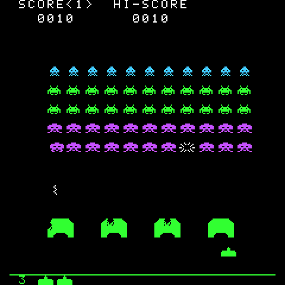

# fm1-insert-coin

Giochi arcade degli anni '80 come firmware per il sintetizzatore tascabile **M-Vave FM-1**.

L'FM-1 è un synth FM da pochi euro con uno schermo a colori 240 × 240, 27 tasti, 14 pulsanti e 7 encoder. Da quando il produttore ha aperto il firmware, la community ne ha scritti più di cento, quasi tutti strumenti musicali; qualcuno ci ha fatto girare Doom. Qui ci girano i classici arcade, ricostruiti fedelmente a partire dalle ricerche su hardware e software originali.

<p align="center"></p>

## I giochi

| Gioco | Stato | Comandi |
| --- | --- | --- |
| Space Invaders (Taito, 1978) | Giocabile, con i suoni e il simulatore nel browser | OP1 OP2 OP3 sinistra, OP4 OP5 fuoco, OP6 PIT GLO destra, PLAY per iniziare, FX colori |
| Galaga (Namco, 1981) | Previsto | Come Space Invaders |
| Breakout (Atari, 1976) | Previsto | Encoder SELECT (destrorsi) o KNOB1 (mancini) |

I giochi sono il porting in C della versione web di [insert-coin](https://github.com/DarkHelmet67/insert-coin), giocabile su [darkhelmet67.github.io/insert-coin](https://darkhelmet67.github.io/insert-coin/). La logica TypeScript è la specifica: il C deve fare la stessa partita, fotogramma per fotogramma.

## Installare un gioco sul synth

> Installare un firmware di terze parti è a tuo rischio. Prima salva i tuoi progetti e i suoni con il Workbench ufficiale.

1. Scarica il file `.fwsc` del gioco dagli artefatti dell'ultima esecuzione di [GitHub Actions](../../actions) (le release arriveranno con il primo gioco completo).
2. Collega l'FM-1 al computer via USB e installa con `python3 platform/tools/fm1_install.py space-invaders.fwsc`, oppure dal [FM-1 Firmware Hub](https://thefirmwarehub.com) in Chrome o Edge.
3. Per tornare al firmware ufficiale V15: lo stesso hub, voce "FM-1 V15".

Se qualcosa va storto, tieni premuto **OCT-** mentre accendi: l'FM-1 parte nella modalità di recupero USB, dove l'installazione funziona sempre.

## Provare senza synth

**Nel browser.** Il [simulatore](https://darkhelmet67.github.io/fm1-insert-coin/) fa girare lo stesso codice C del firmware, compilato in WebAssembly: schermo, tastiera, pulsanti e suono dell'FM-1, con il mouse, le dita o la tastiera del computer ([guida 07](docs/07-simulatore.md)).

**Sul computer.** La modalità host di [Dinghy](https://github.com/zvenson/dinghy) fa girare il firmware: lo schermo diventa una serie di PNG, il suono un WAV, i tasti arrivano da uno script.

```sh
pip3 install Pillow
make test                         # i test unitari
make host GAME=space-invaders     # -> build/host/space-invaders-*.png e .wav
make sim GAME=space-invaders      # -> build/site/space-invaders/index.html (serve clang con lld)
```

Serve solo un compilatore C (Linux o macOS).

## Costruire il firmware

Il firmware si costruisce con la toolchain JieLi (Linux x86-64; su macOS lo script usa Docker da solo) e tre file dell'SDK AC79:

```sh
pip3 install Pillow
sh platform/tools/get_toolchain.sh
git clone --depth 1 --branch AC79NN_SDK_V1.2.1_2023-12-13 \
    https://gitee.com/Jieli-Tech/fw-AC79_AIoT_SDK.git ~/fw-AC79_AIoT_SDK
export JIELI_TOOLCHAIN=~/.jieli/toolchain AC79_SDK=~/fw-AC79_AIoT_SDK
python3 tools/build.py space-invaders   # -> build/space-invaders/space-invaders.fwsc
```

GitHub Actions fa lo stesso a ogni push e allega i `.fwsc` all'esecuzione.

## Com'è fatto

```
platform/   Dinghy: avvio, USB, aggiornamento, tasti, schermo, audio, flash, modalità host (non si tocca)
libs/       il nostro codice condiviso tra i giochi, in C puro e testato
games/      un gioco per cartella: src/main.c parla con l'FM-1, il resto è logica pura
tools/      build.py (il firmware di un gioco), ppm_to_png.py (gli screenshot), traces/ (il registratore delle tracce)
docs/       le guide, passo dopo passo
```

## Guide

| | |
| --- | --- |
| [00 Introduzione](docs/00-introduzione.md) | Perché un synth, perché il C, il piano |
| [01 La piattaforma](docs/01-piattaforma.md) | Dinghy, la modalità host, la build, il primo firmware |
| [02 Lo schermo](docs/02-schermo.md) | Risoluzioni diverse sul display 240 × 240, solo le righe cambiate, 60 Hz |
| [03 Le tracce](docs/03-tracce.md) | Partite registrate dalla versione web, per dimostrare che il C è lo stesso gioco |
| [04 La logica](docs/04-logica.md) | Space Invaders in C, modulo per modulo, identico alla versione web su 32.000 fotogrammi |
| [05 Grafica e comandi](docs/05-grafica-e-controlli.md) | Disegnare tutto e inviare poco, i tasti del synth, il record nella flash |
| [06 I suoni](docs/06-suoni.md) | Un sintetizzatore a interi con gli stessi numeri del web, misurato contro Web Audio |
| [07 Il simulatore](docs/07-simulatore.md) | Lo stesso C in WebAssembly, in una pagina che si apre anche dal disco |
| [Diario AI](docs/ai-workflow.md) | Le decisioni prese con Claude |
| [Prompt unico](docs/prompt-unico.md) | Il prompt che ricrea il progetto |

Le regole di sviluppo sono in [CLAUDE.md](CLAUDE.md).

## Licenza

GPL-3.0-only, come Dinghy da cui deriva. Crediti e materiale di terzi in [LICENSING.md](LICENSING.md).
