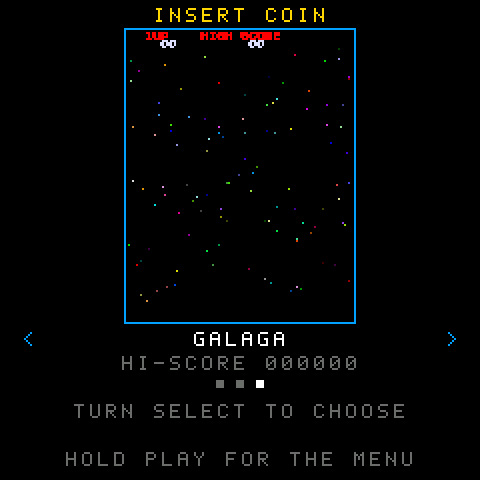
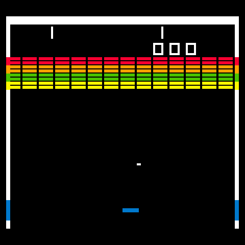

# fm1-insert-coin

1980s arcade games as firmware for the **M-Vave FM-1** pocket synthesizer.

The FM-1 is an inexpensive FM synth with a 240 × 240 colour screen, 27 keys, 14 buttons and 7 encoders. Since its maker opened the firmware, the community has written more than a hundred of them, nearly all musical instruments; someone even got Doom running. This repository runs arcade classics on it, faithfully rebuilt from research on the original hardware and software.

<p align="center">   </p>

## The games

| Game | Status | Controls |
| --- | --- | --- |
| Space Invaders (Taito, 1978) | Playable, with sound | OP1 OP2 OP3 left, OP4 OP5 fire, OP6 PIT GLO right, PLAY to start, FX colours |
| Breakout (Atari, 1976) | Playable, with sound | Any encoder moves the paddle, PLAY serves, FX colours |
| Galaga (Namco, 1981) | Playable, with the original's music and effects | Same as Space Invaders |

All three are in one firmware, `insert-coin`, which opens on a menu: turn **SELECT**, **PRESETS** or **ALGORITHM** to choose a game (its attract screen plays in the middle), press **PLAY** to enter it, hold **PLAY** for two seconds to come back. Each game keeps its own high score in the synth's memory, even when it is switched off.

The games are C ports of the web version in [insert-coin](https://github.com/DarkHelmet67/insert-coin), playable at [darkhelmet67.github.io/insert-coin](https://darkhelmet67.github.io/insert-coin/). The TypeScript logic is the specification: the C code must play the same game, frame by frame.

## How to play

| Action | On the synth | In the simulator, from a computer |
| --- | --- | --- |
| Choose a game in the menu | SELECT, PRESETS or ALGORITHM | Up and Down arrows |
| Enter it / back to the menu | PLAY / hold PLAY 2 s | Enter / hold Enter |
| Left (Space Invaders, Galaga) | OP1, OP2, OP3 | Left arrow, A |
| Fire (Space Invaders, Galaga) | OP4, OP5 | Space, W |
| Right (Space Invaders, Galaga) | OP6, PIT, GLO | Right arrow, D |
| Move the paddle (Breakout) | Any encoder | Left and right arrows |
| Coin and start, serve | PLAY (blinking) | Enter, C |
| Colour or black and white (Space Invaders, Breakout) | FX | V |

## Installing on the synth

> Installing third-party firmware is at your own risk. Back up your projects and sounds with the official Workbench first.

**From the browser (the easiest way).** Open the [installer](https://darkhelmet67.github.io/fm1-insert-coin/installer/) in Chrome or Edge on a computer, connect the FM-1 (switched on) with a USB data cable, and press **Install**. It works from the official V15 firmware too, and if the cable comes out it carries on where it stopped ([guide 09](docs/09-installer.md)).

**From the command line.** Download `insert-coin.fwsc` from the installer page (or from the [GitHub Actions](../../actions) artifacts) and install it with `python3 platform/tools/fm1_install.py insert-coin.fwsc` (needs `pip3 install mido python-rtmidi`). The [FM-1 Firmware Hub](https://thefirmwarehub.com) works as well.

**Back to the official V15 firmware:** M-VAVE's M-UPGRADE with the FM-1 V15 file from their site, or the same hub, entry "FM-1 V15".

If something goes wrong, hold **OCT-** while switching on: the FM-1 starts in USB rescue mode, where installing always works.

## Trying it without a synth

**In the browser.** The [simulator](https://darkhelmet67.github.io/fm1-insert-coin/) runs the same C code as the firmware, compiled to WebAssembly: the FM-1's screen, keyboard, buttons and sound, played with the mouse, your fingers or the computer keyboard ([guide 07](docs/07-simulator.md)). Every pull request also gets its own preview of the site at `/pr-<number>/`.

**On the computer.** [Dinghy](https://github.com/zvenson/dinghy)'s host mode runs the firmware: the screen becomes a series of PNGs, the sound a WAV, and the keys come from a script.

```sh
pip3 install Pillow
make test                         # the unit tests
make host                         # the menu and the three games -> build/host/insert-coin-*.png and .wav
make sim                          # -> build/site/simulator/index.html (needs clang with lld)
```

All it takes is a C compiler (Linux or macOS). On macOS the simulator needs Homebrew's clang, since Apple's cannot target WebAssembly: `brew install llvm lld`, then `PATH="$(brew --prefix lld)/bin:$PATH" make sim WASM_CC="$(brew --prefix llvm)/bin/clang"`.

## Building the firmware

The firmware is built with the JieLi toolchain (Linux x86-64; on macOS the script uses Docker by itself) and three files of the AC79 SDK:

```sh
pip3 install Pillow
sh platform/tools/get_toolchain.sh
git clone --depth 1 --branch AC79NN_SDK_V1.2.1_2023-12-13 \
    https://gitee.com/Jieli-Tech/fw-AC79_AIoT_SDK.git ~/fw-AC79_AIoT_SDK
export JIELI_TOOLCHAIN=~/.jieli/toolchain AC79_SDK=~/fw-AC79_AIoT_SDK
python3 tools/build.py                  # -> build/insert-coin/insert-coin.fwsc
```

GitHub Actions does the same on every push and attaches the `.fwsc` to the run.

## How it is built

```
platform/   Dinghy: boot, USB, updates, keys, screen, audio, flash, host mode (left untouched)
libs/       code shared by the games, plain tested C: screen, font, sprite, input, clock,
            audio (synthesizer and Namco WSG chip), cartridge (the game interface), trace
launcher/   the firmware: the menu, the records, src/main.c (the only file that talks to the
            FM-1) and sim/sim.c (the same firmware in the browser)
games/      one game per folder, pure logic, compiled as one file (unity.c) and seen by the launcher
            as a cartridge; traces/ holds games recorded from the web version
sim/        the simulator page, the same for every game
installer/  the web installer page; vendor/ holds Felucca's update protocol (from Skiff)
tools/      build.py (the firmware), ppm_to_png.py (screenshots), traces/ (the trace recorders),
            galaga/ (Galaga's data tables from the web version),
            sounds/ (the sound comparison), sim/ (simulator page and tests),
            installer/ (the site with the packages, the fake FM-1 for tests)
docs/       the guides, step by step
```

## Guides

| | |
| --- | --- |
| [00 Introduction](docs/00-introduction.md) | Why a synth, why C, the plan |
| [01 The platform](docs/01-platform.md) | Dinghy, host mode, the build, the first firmware |
| [02 The screen](docs/02-screen.md) | Different resolutions on the 240 × 240 display, only the changed rows, 60 Hz |
| [03 The traces](docs/03-traces.md) | Games recorded from the web version, to prove the C code is the same game |
| [04 The logic](docs/04-logic.md) | Space Invaders in C, module by module, identical to the web version over 32,000 frames |
| [05 Graphics and controls](docs/05-graphics-and-controls.md) | Draw everything, send little; the synth's keys; the high score in flash |
| [06 Sounds](docs/06-sounds.md) | An integer synthesizer with the web version's numbers, measured against Web Audio |
| [07 The simulator](docs/07-simulator.md) | The same C code in WebAssembly, in a page that also opens from disk |
| [08 Summary](docs/08-summary.md) | How it fits together, what is verified, how to add a game |
| [09 The installer](docs/09-installer.md) | Installing from the browser with WebMIDI, Felucca's protocol, tests with a fake FM-1, PR previews |
| [10 The launcher](docs/10-launcher.md) | One firmware, a menu of games, games as cartridges, the unity build |
| [11 Breakout](docs/11-breakout.md) | A paddle on any encoder, the ball in exact fifths of a pixel |
| [12 Galaga](docs/12-galaga.md) | 60 modules, 58,000 frames of parity, 288 rows on 240, the WSG sound chip |
| [13 Counting visitors](docs/13-analytics.md) | GoatCounter on the published site: visits, installs and downloads, no cookies |
| [AI diary](docs/ai-workflow.md) | The decisions made with Claude |
| [Single prompt](docs/single-prompt.md) | The prompt that recreates the project |

The development rules are in [CLAUDE.md](CLAUDE.md).

## License

GPL-3.0-only, like Dinghy, which it derives from. Credits and third-party material in [LICENSING.md](LICENSING.md).
