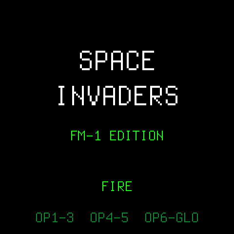

# 01 La piattaforma

Il primo passo mette in piedi il necessario per scrivere un gioco senza toccare l'hardware: la piattaforma Dinghy, la build del firmware, la modalità host, i test e la CI. Il risultato è un firmware con il titolo di Space Invaders e gli otto tasti di gioco accesi.

<p align="center"></p>

## Come gira un'app su Dinghy

Un firmware Dinghy è una sola unità di compilazione: il file dell'app include `platform.c` e definisce due funzioni.

```c
#include "platform.c"

static void app_audio(int32_t *out, uint32_t n);   /* l'interrupt audio: n campioni stereo da riempire */
static void app_main(void);                        /* il ciclo principale: non ritorna mai */
```

`app_main()` deve chiamare spesso `platform_poll()`: tiene vivo il watchdog (8 secondi, poi l'FM-1 si riavvia), serve l'USB e quindi l'aggiornamento. I tasti sono bit di `fm1_in.notes` (bit 0 = F3, bit 26 = G5), i LED si accendono con `fm1_led_key()`, il testo si scrive con `draw_text_box()`. Il riferimento completo è [platform/docs/API.md](../platform/docs/API.md); le regole del chip (niente `float`, niente divisione a 64 bit, cosa non fare nell'interrupt audio) sono in [platform/docs/RULES.md](../platform/docs/RULES.md).

## Il confine con l'hardware

In questo repository solo `games/<gioco>/src/main.c` include `platform.c`. Tutto il resto, in `games/<gioco>/src/` e in `libs/`, è C puro: niente registri, niente schermo, niente variabili globali. `tools/build.py` lo compila file per file e lo collega al firmware; `make test` lo compila sul computer con i suoi test.

Il primo modulo puro è la mappa dei tasti, in `libs/input/keymap.c`: dato l'insieme dei tasti premuti, restituisce le azioni (sinistra, destra, fuoco). Sinistra e destra insieme si annullano, come nella versione web. I tasti di ogni gioco stanno nel suo `config.h`:

```c
static const KeyMap CONTROLS = {
    .left = FM1_KEY_BIT(FM1_KEY_OP1) | FM1_KEY_BIT(FM1_KEY_OP2) | FM1_KEY_BIT(FM1_KEY_OP3),
    .fire = FM1_KEY_BIT(FM1_KEY_OP4) | FM1_KEY_BIT(FM1_KEY_OP5),
    .right = FM1_KEY_BIT(FM1_KEY_OP6) | FM1_KEY_BIT(FM1_KEY_PIT) | FM1_KEY_BIT(FM1_KEY_GLO),
};
```

I nomi OP1...GLO sono le etichette stampate sui tasti neri. A quale bit corrisponde ciascuno lo dice la tabella `edit_keys` del firmware ufficiale ([app/screen.c di fm1_open](https://github.com/m-vave/fm1_open/blob/main/app/screen.c)): OP1 è F#3, il bit 1.

## I test

Un test è un programma: `keymap_test.c` accanto a `keymap.c`, con un `main()` che lancia i casi uno per uno. L'harness è `libs/test/check.h`, poche righe: `CHECK(condizione)` e `CHECK_EQ(valore, atteso)` segnalano il fallimento senza fermare il test, così un'esecuzione mostra tutti gli errori.

```sh
make test
```

## La modalità host

`make host GAME=space-invaders` compila il gioco con `-DDINGHY_HOST`: `platform.c` include allora `platform/tests/host.c`, un FM-1 finto. Ogni chiamata a `platform_poll()` vale un millisecondo; uno script preme i tasti nel tempo e chiede gli screenshot.

```
# games/space-invaders/scripts/title.txt
500 shot
600 keys 0x2          # OP1 (bit 1): sinistra
900 shot
1400 keys 0x22102     # OP1 + OP4 + GLO: sinistra e destra si annullano, resta il fuoco
1700 shot
2000 end
```

Escono `build/host/space-invaders-<ms>.png` e `build/host/space-invaders.wav`.

## La build del firmware

`python3 tools/build.py space-invaders` fa ciò che faceva `build.sh` di Dinghy, per una cartella di gioco: compila `main.c` con la piattaforma e i moduli puri, collega, costruisce il caricatore di aggiornamento e impacchetta il `.fwsc`. Prima di scrivere il pacchetto controlla ciò che brickerebbe l'FM-1: un'immagine troppo grande, troppa RAM, una chiamata alla ROM del chip, un registro toccato fuori da `platform/firmware/hal/`.

Ogni gioco ha il suo `firmware.json`:

```json
{ "identity": "FM-1_95", "screen_name": "SPACE INVADERS", "screen_colour": "0x07E0" }
```

L'identità è il nome con cui l'FM-1, gli installer e il Firmware Hub riconoscono il firmware; la cifra finale è la versione minore (`FM-1_950` per le build di sviluppo). Le identità `9NN` già prese sono elencate in [platform/docs/MAKE-IT-YOURS.md](../platform/docs/MAKE-IT-YOURS.md); `95N` va confermata con il Firmware Hub prima del primo rilascio.

## La CI

`.github/workflows/ci.yml` gira a ogni push e pull request in due lavori. Il primo controlla la formattazione, esegue i test e fa girare ogni gioco in modalità host, allegando gli screenshot. Il secondo scarica la toolchain JieLi e l'SDK AC79 e costruisce il `.fwsc` di ogni gioco, allegandolo all'esecuzione: è da lì che si scarica il firmware da installare.
