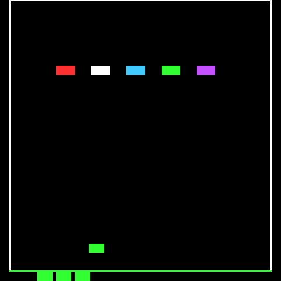

# 02 Lo schermo

Il secondo passo costruisce lo strato schermo condiviso dai giochi: ogni gioco disegna alla sua risoluzione originale, e una libreria decide dove cade sul display 240 × 240 dell'FM-1 e quali righe inviare. Il risultato si vede in un cartellino di prova, con un blocco che i tasti di gioco muovono a 60 fotogrammi al secondo.

<p align="center"></p>

## Il problema

| Gioco | Risoluzione originale | Sul display 240 × 240 |
| --- | --- | --- |
| Breakout | 228 × 208 | Entra intero, centrato |
| Space Invaders | 224 × 256 | 16 righe di troppo |
| Galaga | 224 × 288 | 48 righe di troppo |

Le colonne non sono mai un problema: tutti i giochi sono larghi al massimo 228 pixel. Le righe sì. Scalare 256 righe a 240 vorrebbe dire perderne una ogni sedici, e gli sprite di 8 righe ne uscirebbero deformati. Il secondo vincolo è la velocità: il display riceve i pixel su un bus SPI, e un'immagine intera richiede circa 31 ms, più dei 16,7 ms di un fotogramma.

## Tre pezzi

**Il framebuffer** (`libs/screen/framebuffer.c`) è lo schermo del gioco: un byte per pixel, l'indice di uno dei 16 colori, e un bit per riga che dice se la riga è cambiata. `fb_set()` segna la riga solo se il pixel cambia davvero, così ridisegnare un oggetto fermo non costa nulla. Per Galaga sono 224 × 288 = 64 KB: sull'FM-1 il framebuffer sta nel pool di memoria da 336 KB.

**La mappa** (`libs/screen/screen_map.c`) dice, per ognuna delle 240 righe del display, quale riga del gioco mostra, o nessuna. Un solo meccanismo copre tutti i casi:

- `screen_map_centered(228, 208)`: Breakout centrato, 16 righe nere sopra e sotto;
- `screen_map_rows(224, righe, n)`: solo alcune serie di righe, impilate. Space Invaders mostra le righe 8-239 (le 8 in alto sono vuote nell'originale) e 243-250 (i cannoni di riserva), saltando le tre righe vuote sotto la linea verde: 232 + 8 = 240, pixel per pixel;
- per Galaga deciderà il passo dedicato: lo stesso meccanismo può tagliare, saltare righe o ripeterle.

**L'invio** (`libs/screen/screen_push.c`) trova le righe del display da spedire: `screen_next_band()` restituisce la prossima serie di righe consecutive cambiate, lunga al massimo quanto il buffer, e `screen_render_row()` colora una riga con la tavolozza.

## Il collegamento all'hardware

Le tre librerie sono C puro, con i loro test. Chi parla col display è `libs/screen/screen_fm1.h`, incluso da `main.c` dopo `platform.c`. `screen_push()` scorre le bande, colora ognuna in un buffer e la passa a `lcd_blit()`:

```c
for (ScreenBand band = screen_next_band(fb, map, 0u, SCREEN_BAND_ROWS); band.count;
     band = screen_next_band(fb, map, band.y + band.count, SCREEN_BAND_ROWS)) {
    uint16_t *px = screen_band_px[which];
    for (uint32_t r = 0; r < band.count; r++)
        screen_render_row(fb, map, band.y + r, palette, &px[r * map->width]);
    lcd_blit(map->dest_x, band.y, map->width, band.count, px);
    which ^= 1u;
}
```

`lcd_blit()` torna subito e lascia lavorare il DMA, che continua a leggere il buffer. Per questo i buffer sono due: mentre uno viaggia, l'altro si riempie. La chiamata successiva a `lcd_blit()` aspetta la fine del trasferimento precedente, quindi un buffer non viene mai riscritto mentre è in viaggio. I colori passano da `screen_palette()`, che li mette nell'ordine dei byte del display.

## Il tempo

Il gioco originale avanza a 60 fotogrammi al secondo, l'FM-1 conta i millisecondi. `frame_clock_frames(ms)` (`libs/clock/`) dice quanti fotogrammi valgono: 60 ogni 1000 ms esatti, senza deriva e senza la divisione a 64 bit che il chip non sa fare. Il ciclo principale esegue i fotogrammi dovuti, al massimo quattro di fila se è rimasto indietro (per esempio durante un salvataggio in flash), poi invia le righe cambiate.

```c
const uint32_t due = frame_clock_frames(fm1_ms);
if (due - done > MAX_CATCH_UP)
    done = due - MAX_CATCH_UP;
for (; done != due; done++)
    step(keymap_actions(&CONTROLS, notes));
screen_push(&screen, &map, palette);
```

## Su macOS

La modalità host compila anche sul Mac, con una correzione nel `Makefile`: il formato Mach-O vuole i nomi di sezione nella forma `segmento,sezione`, mentre Dinghy dichiara i buffer grandi in `.pool`. Sul computer il pool non significa nulla, e il `Makefile` lo rinomina solo su macOS.
