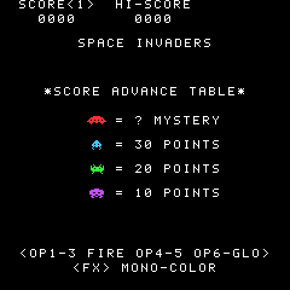
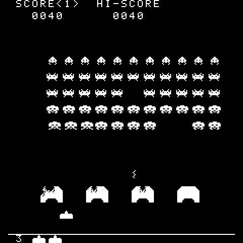

# 05 · Graphics, controls and high score

With the logic identical to the web version ([guide 04](04-logic.md)), everything you see and touch is missing: drawing the game, reading the synth's keys, the screens, the saved high score. At the end of this step Space Invaders plays from start to game over.

<p align="center">



</p>

## Draw everything, send little

The web version redraws the whole canvas every frame: it is the simplest way and the browser does not mind. On the synth the problem is the display: a whole image costs 31 ms of SPI, more than a frame ([guide 02](02-screen.md)). The solution keeps the web version's simplicity:

1. `render_game()` draws the frame **from scratch** into a framebuffer, `back`, like `renderGame` on the canvas;
2. `fb_present(&front, &back)` compares the two images row by row and copies into `front` only the rows that differ, marking them as changed;
3. `screen_push_band()` sends only those to the display, a band of rows at a time (since [guide 12](12-galaga.md); in this step it was `screen_push()`, all the bands at once).

```c
render_game(&back, &game);
fb_present(&front, &back);
screen_push_band(&front, &map, palette); /* again and again, until it returns 0 */
```

In a game few rows change per frame: the invader that moved, the shot, the bombs, the cannon. Comparing 57,000 bytes costs a fraction of a millisecond; the transfer it saves is worth tens of milliseconds.

The drawing follows the web version's `render-*.ts` files, function by function (`render_header`, `render_ground_and_lives`, `render_playing`, `render_attract`), with the same coordinates. Two new libraries make it possible:

- `libs/screen/draw.h`: `fb_draw_sprite()`, `fb_draw_bitmap()` (the damaged shields) and `fb_clear()`;
- `libs/font`: insert-coin's 5 × 7 font (`ARCADE_FONT`), copied character by character, with `fb_draw_text()` and `fb_draw_text_centered()`.

Galaga and Breakout will use both.

## Colour and black and white

The framebuffer holds colour indexes, not colours: the palette is applied only when sending. To switch from the coloured film to the black and white monitor (the V key on the web, **FX** on the synth) it is enough to change palette and send every row again: the game redraws nothing. The two palettes, `COLORS` and `MONO_COLORS`, are in `config.c` with the same values as `colors.config.ts`.

## The controls

| Action | FM-1 key | As on the web |
| --- | --- | --- |
| Left | OP1, OP2, OP3 | Left arrow, A |
| Fire | OP4, OP5 | Space |
| Right | OP6, PIT, GLO | Right arrow, D |
| Coin and start | PLAY | C, 5 |
| Colour / black and white | FX | V |

`input_controls()` turns the synth's state into the logic's `Controls`, with the same rules as the web: movement follows the keys held down (left and right together cancel out), fire and coin are **presses**: holding OP4 does not fire repeatedly. The function is pure and tested: it receives the keys of now and of the frame before. (In step 7 it moved to receiving the key presses directly.)

The LEDs help find the keys: the game keys glow dimly and light up when you press them; PLAY blinks while a game can be started.

The choice of keys and buttons is in `config.h` (`CONTROLS`, `COIN_BUTTON`, `COLOR_BUTTON`): whoever prefers other keys changes one line.

## The attract screen

The same as the web version's, with one adaptation: the last two lines name the synth's keys instead of the computer's, and move up a few pixels, because row 240 of the original does not reach the display (the rows shown are 8-239 and 243-250). "PRESS PLAY" blinks like "INSERT COIN": on for half a second, off for the other half.

## The high score

The web version saves the high score in the browser with `@arcade/storage`; here it goes into the synth's flash, with Dinghy's `settings_save()`, through `libs/storage/hi_score_fm1.h` (since [guide 10](10-launcher.md) the launcher keeps one record per game in `launcher/src/records.c`, with the same rules):

- the high score is loaded at power-on (`hi_score_load()`, 0 if there is nothing or if the data belongs to another firmware);
- it is saved **after** the game, when game over appears: erasing a flash sector stops the interrupts for about 50 ms, and during play you would see a stutter;
- `STORE_MAGIC` ("INVD"), defined in `main.c` before `platform.c`, tells our data from other firmwares'.

## The main loop

`main.c` is the imperative shell around the pure logic (as it was in this step; step 7 moved the frame into `app.c`):

```c
for (;;) {
    platform_poll();                                   /* USB, keys, watchdog */
    ... how many frames are due (frame_clock, at most 4 to catch up)
    for (; done != due; done++) {
        const Controls controls = input_controls(&CONTROLS, notes, previous_notes, presses, COIN_BUTTON);
        game = game_step(&game, &controls);
    }
    ... save the high score if it changed and the game is over
    render_game(&back, &game);
    fb_present(&front, &back);
    light_keys(notes);
    screen_push(&front, &map, palette);
}
```

When the loop catches up several frames (after a save, for example), a press counts in the first one only: one shot stays one shot.

## Trying it

```sh
make host
```

The script `launcher/scripts/demo.txt` enters Space Invaders from the menu, presses PLAY, moves, fires and switches to black and white (then plays the other games): the pictures above come from there.
