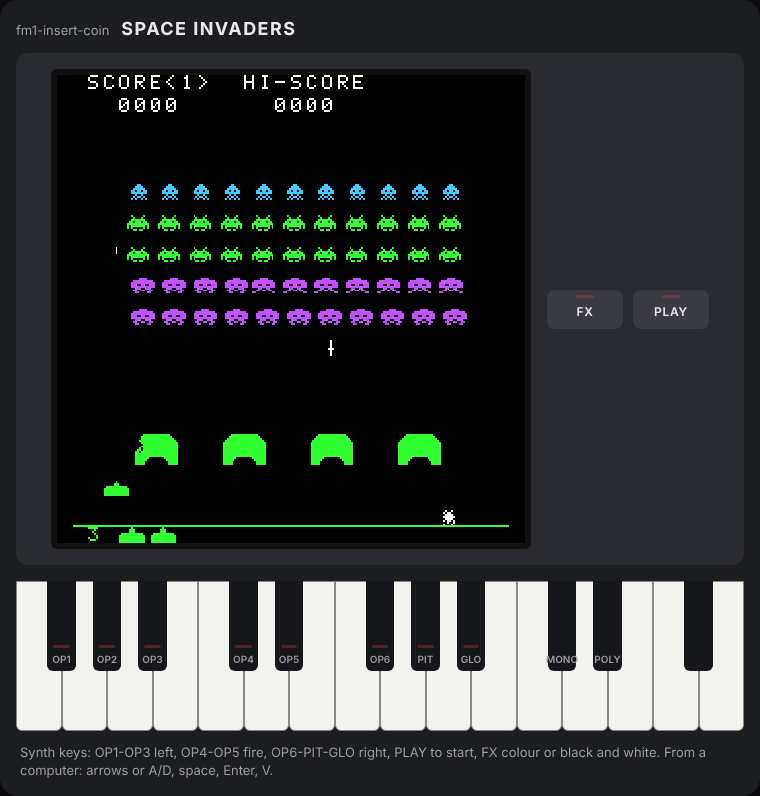

# 07 · The browser simulator

Installing a firmware on the synth to try every change is slow, and not everyone has an FM-1. The simulator runs the game in a web page: the screen, the keyboard with its OP1-GLO labels, the FX and PLAY buttons with their LEDs, the sound. It is not an imitation: it is **the same C code as the firmware**, compiled to WebAssembly.

<p align="center"></p>

You play by touching the keys drawn on the page (with several fingers too, on a phone) or from the computer keyboard: arrows or A/D to move, space or W to fire, Enter (or C, the web version's coin) for PLAY, V for FX.

## The same code, two shells

Up to step 6 the loop of a frame lived in `main.c`. For the simulator it moved to `app.c`, pure and tested:

```c
App app_step(const App *app, uint32_t notes, uint32_t note_presses, uint32_t button_presses);
```

One frame of the cabinet: from keys to controls (`input_controls`), the game (`game_step`), the sounds (`sounds_for`), the colour switch with FX. Around it sit two thin shells:

| | Firmware (`launcher/src/main.c`) | Simulator (`launcher/sim/sim.c`) |
| --- | --- | --- |
| Keys | `fm1_in.notes`, `fm1_input_edges()` | browser events, from `sim.js` |
| Frame | `app_step` | `app_step` |
| Drawing | `render_game` → `fb_present` → `screen_push_band` (SPI) | `render_game` → `screen_render_row` → RGBA for the canvas |
| Sound | `audio_render` in the interrupt | `mixer_render` in a `ScriptProcessor` |
| High score | flash, `settings_save` | the browser's `localStorage` |

Everything between the two shells is identical: if the simulator behaves, so does the firmware, hardware aside.

## WebAssembly without special tools

No Emscripten: the system clang with its WebAssembly linker (`wasm-ld`, package `lld`) is enough.

```sh
make sim      # -> build/site/simulator/index.html
```

```
clang --target=wasm32 -O2 -nostdlib -ffreestanding -Wl,--no-entry ...
```

`-nostdlib` means no C library, as on the synth: the game uses none, apart from `memcpy` and `memset`, which the compiler calls to copy structs and which `sim/libc.c` provides in twenty lines (on the synth Dinghy provides them). The functions the page calls are marked with `SIM_EXPORT(name)`, that is `__attribute__((export_name("name")))`. The result weighs 30 KB.

On macOS, Apple's clang cannot target WebAssembly: use Homebrew's (`brew install llvm lld`), with `PATH="$(brew --prefix lld)/bin:$PATH" make sim WASM_CC="$(brew --prefix llvm)/bin/clang"`.

The page is a single HTML file with the style, the script and the WebAssembly as base64 inside (`tools/sim/bundle.py`): it also opens with a double click from disk, without a server.

## The page does not know the game

`sim/sim.js` only knows what an FM-1 looks like: 27 keys, the labels of the black keys, the buttons. It asks the game which keys it uses (`sim_game_keys`, for the LEDs), which button starts a game and which one switches the colours. Since the launcher ([guide 10](10-launcher.md)) the page runs the whole firmware, menu and games, through `launcher/sim/sim.c`, and draws the seven encoders too.

Time is the browser's (`requestAnimationFrame`), divided into 1/60-second frames with at most 4 to catch up, like `frame_clock` on the synth. Presses add up between one frame and the next: a very short tap is not lost.

## Trying it and checking it

- **In the browser:** `build/site/simulator/index.html`; after the merge to `main`, on GitHub Pages.
- **From a pull request:** the pull request's preview on GitHub Pages, in `pr-<number>/` ([guide 09](09-installer.md)); or the `simulator` artifact of GitHub Actions, which you download, unzip and open.
- **Automatically, in CI:** `tools/sim/smoke.mjs` loads the WebAssembly in Node, presses PLAY, fires and checks screen and sound.
- **Automatically, locally:** `tools/sim/test.mjs` opens the page in Chromium with Playwright, plays a few seconds with the keyboard, checks that it runs at 60 frames per second with no errors and saves the screenshots in `build/sim/`.

## GitHub Pages

The workflow publishes the site on every push to `main` (jobs `publish` and `pages`, with `actions/deploy-pages`), and pull requests in `pr-<number>/` (`preview.yml`, [guide 09](09-installer.md)). Once only, **GitHub Actions** must be chosen as the source in the repository's Settings → Pages.
