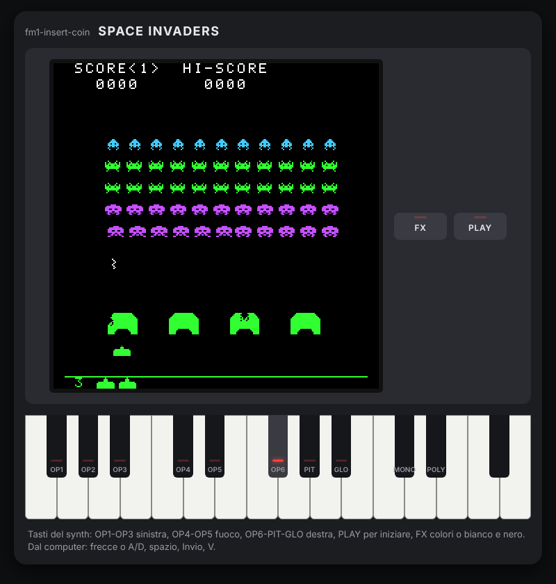

# 07 · Il simulatore nel browser

Installare un firmware sul synth per provare ogni modifica è lento, e non tutti hanno un FM-1. Il simulatore fa girare il gioco in una pagina web: lo schermo, la tastiera con le etichette OP1-GLO, i pulsanti FX e PLAY con i loro LED, il suono. Non è un'imitazione: è **lo stesso codice C del firmware**, compilato in WebAssembly.

<p align="center"></p>

Si gioca toccando i tasti disegnati (anche con più dita, sul telefono) o dalla tastiera del computer: frecce o A/D per muoversi, spazio o W per sparare, Invio (o C, la moneta della versione web) per PLAY, V per FX.

## Lo stesso codice, due gusci

Fino al passo 6 il ciclo di un fotogramma stava in `main.c`. Per il simulatore è stato spostato in `app.c`, puro e testato:

```c
App app_step(const App *app, uint32_t notes, uint32_t note_presses, uint32_t button_presses);
```

Un fotogramma del cabinato: dai tasti ai comandi (`input_controls`), il gioco (`game_step`), i suoni (`sounds_for`), il cambio di colori con FX. Attorno ci sono due gusci sottili:

| | Firmware (`src/main.c`) | Simulatore (`sim/sim.c`) |
| --- | --- | --- |
| Tasti | `fm1_in.notes`, `fm1_input_edges()` | eventi del browser, da `sim.js` |
| Fotogramma | `app_step` | `app_step` |
| Disegno | `render_game` → `fb_present` → `screen_push` (SPI) | `render_game` → `screen_render_row` → RGBA per il canvas |
| Suono | `audio_render` nell'interrupt | `mixer_render` in uno `ScriptProcessor` |
| Record | flash, `settings_save` | `localStorage` del browser |

Tutto ciò che sta fra i due gusci è identico: se il simulatore si comporta bene, anche il firmware lo fa, salvo l'hardware.

## WebAssembly senza strumenti speciali

Niente Emscripten: basta il clang di sistema con il suo linker WebAssembly (`wasm-ld`, pacchetto `lld`).

```sh
make sim GAME=space-invaders      # -> build/site/space-invaders/index.html
```

```
clang --target=wasm32 -O2 -nostdlib -ffreestanding -Wl,--no-entry ...
```

`-nostdlib` vuol dire nessuna libreria C, come sul synth: il gioco non ne usa, a parte `memcpy` e `memset` che il compilatore chiama per copiare le struct, e che `sim/libc.c` fornisce in venti righe (sul synth le fornisce Dinghy). Le funzioni che la pagina chiama sono marcate con `SIM_EXPORT(nome)`, cioè `__attribute__((export_name("nome")))`. Il risultato pesa 30 KB.

La pagina è un unico file HTML con dentro stile, script e il WebAssembly in base64 (`tools/sim/bundle.py`): si apre anche con un doppio clic dal disco, senza server.

## La pagina non conosce il gioco

`sim/sim.js` sa solo com'è fatto un FM-1: 27 tasti, le etichette dei tasti neri, i pulsanti. Chiede al gioco quali tasti usa (`sim_game_keys`, per i LED), quale pulsante inizia la partita e quale cambia i colori. Galaga e Breakout useranno la stessa pagina con il loro `sim.c`.

Il tempo è quello del browser (`requestAnimationFrame`), diviso in fotogrammi da 1/60 di secondo con al massimo 4 di recupero, come `frame_clock` sul synth. Le pressioni si accumulano fra un fotogramma e l'altro: un tocco brevissimo non si perde.

## Provarlo e controllarlo

- **Nel browser:** `build/site/space-invaders/index.html`; dopo il merge su `main`, su GitHub Pages.
- **Da una pull request:** l'artefatto `simulator` di GitHub Actions contiene la pagina; si scarica, si scompatta e si apre.
- **In automatico, in CI:** `tools/sim/smoke.mjs` carica il WebAssembly in Node, preme PLAY, spara e controlla schermo e suono.
- **In automatico, in locale:** `tools/sim/test.mjs` apre la pagina in Chromium con Playwright, gioca qualche secondo con la tastiera, controlla che giri a 60 fotogrammi al secondo senza errori e salva le schermate in `build/sim/`.

## GitHub Pages

Il workflow pubblica `build/site` a ogni push su `main` (lavoro `pages`, con `actions/deploy-pages`). Una volta sola va scelto **GitHub Actions** come sorgente in Settings → Pages del repository.
