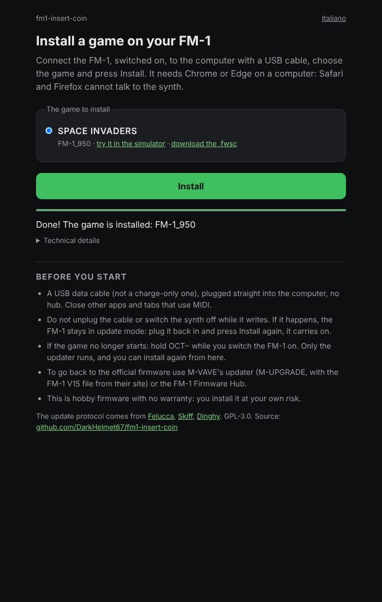

# 09 · L'installer nel browser

Per installare un gioco sul synth bastano Chrome (o Edge) e un cavo USB: si apre la [pagina dell'installer](https://darkhelmet67.github.io/fm1-insert-coin/installer/), si sceglie il gioco e si preme **Installa**. Niente Python, niente programmi da scaricare. È la stessa comodità degli installer di [SLOOP](https://isod89.github.io/sloop-fm1/webapp/installer/) e [Skiff](https://illuminus5.github.io/skiff/webapp/installer/), richiesta da Luca guardando la pull request di Space Invaders.

<p align="center"></p>

## Come parla con il synth

Il browser vede l'FM-1 come un dispositivo MIDI (WebMIDI, con il permesso SysEx). L'aggiornamento è il protocollo di Felucca, che Dinghy ha già dentro `platform/` e che anche `platform/tools/fm1_install.py` parla da riga di comando. Funziona in due tempi, e in entrambi è il synth a chiedere i pezzi del pacchetto, 512 byte alla volta, e la pagina a rispondere:

| Tempo | Chi chiede | Cosa succede |
| --- | --- | --- |
| 0 | La pagina | Domanda di identità: l'FM-1 risponde, per esempio `FM-1_015` (il firmware ufficiale V15) |
| 1 | Il firmware che gira ora | Legge qualche pezzo del pacchetto e si riavvia come caricatore di aggiornamento (per Space Invaders `ota-FM-1_950`, porta USB "Felucca Update") |
| 2 | Il caricatore | Legge tutto il pacchetto e lo scrive nella flash; l'intestazione del gioco per ultima |
| 3 | Il gioco | L'FM-1 si riavvia e la pagina controlla che dica l'identità del pacchetto (`FM-1_950`) |

Il primo tempo funziona dal firmware ufficiale V15 come da un nostro gioco: per questo l'installazione parte da qualsiasi stato. Se il cavo si stacca durante il secondo tempo, l'FM-1 resta nel caricatore (scrivendo l'intestazione per ultima, non parte un gioco a metà): la pagina aspetta che torni e riprende; se la pagina è stata chiusa, alla prossima pressione di Installa trova l'FM-1 nel caricatore e finisce la scrittura.

## Codice nostro e codice di altri

| File | Cosa fa | Di chi |
| --- | --- | --- |
| `installer/vendor/fm1ota.js` | Il protocollo: identità, i due tempi, la ripresa dopo uno stacco, la percentuale | Leo Kuroshita (Felucca), da Skiff, GPL-3.0 |
| `installer/vendor/fm1pkg.js` | Il pacchetto `.fwsc`: identità, immagine logica, file e CRC | Leo Kuroshita (Felucca), da Skiff, GPL-3.0 |
| `installer/package.js` | Scarica il `.fwsc` del gioco e lo controlla (dimensione, SHA-256, identità) prima che il synth ne veda un byte | Nostro |
| `installer/installer.js`, `texts.js`, `index.html`, `style.css` | La pagina: elenco dei giochi, pulsante, barra, messaggi in italiano e inglese | Nostro |

I due moduli di Skiff sono copiati com'erano, con una sola modifica annotata in [installer/UPSTREAM.md](../installer/UPSTREAM.md): su Windows l'uscita MIDI dell'FM-1 si chiama "MIDIOUT2 (Felucca)" e non "Felucca", e la copia di Skiff non la riconosceva. Ora un'uscita vale se il suo nome è quello dell'ingresso o lo contiene, come fa l'installer di SLOOP.

Due regole di prudenza, prese da SLOOP: la pagina non scrive mai su un FM-1 che non sia un FM-1 (un SMK-37, per esempio), e non completa un aggiornamento cominciato dal firmware ufficiale (il suo caricatore, `ota-FM-1_015`, potrebbe disporre la flash in un altro modo): quello si finisce con M-UPGRADE di M-VAVE.

## Una pagina per tutti i giochi

La pagina non conosce Space Invaders. Legge `games.json`, scritto da `tools/installer/bundle.py` con una riga per ogni pacchetto costruito:

```json
{ "game": "space-invaders", "name": "SPACE INVADERS", "product": "FM-1_950",
  "pkg": "../firmware/space-invaders.fwsc", "sha256": "…", "size": 123456 }
```

`bundle.py` controlla ogni pacchetto come lo controlla `fm1_install.py` (identità, caricatore di Felucca dentro, intestazione, elenco dei file e CRC di ognuno) e lo copia in `firmware/`. Quando arriveranno Galaga e Breakout compariranno da soli nell'elenco, con il link al simulatore e al `.fwsc` da scaricare.

## Sul sito

Il sito di GitHub Pages ora si costruisce in tre lavori della CI:

```
firmware ──┐                     ┌── publish ── pages          (push su main: la radice del sito)
           ├── site (artefatto) ─┤
simulator ─┘                     └── preview.yml               (PR pronta: la cartella pr-<numero>/)
```

Il lavoro `site` scarica gli artefatti `simulator` e `firmware`, aggiunge installer e pacchetti con `bundle.py` e carica il risultato come artefatto `site`. Struttura:

```
index.html                  l'elenco dei giochi e il link all'installer
space-invaders/index.html   il simulatore
installer/                  la pagina, i suoi moduli, games.json
firmware/space-invaders.fwsc
```

### L'anteprima di una pull request

Per provare sul synth prima del merge (richiesta di Luca), ogni pull request pronta per la revisione ha il suo sito in `https://darkhelmet67.github.io/fm1-insert-coin/pr-<numero>/`, con simulatore, installer e pacchetti della PR; un commento sulla PR dà il link. È lo schema delle anteprime di insert-coin:

- **Un archivio.** Pages pubblica una cartella intera per volta: per tenere insieme il sito di `main` e le anteprime, il sito pubblicato vive sul branch `gh-pages`. `.github/actions/publish-pages` cambia solo la sua parte: la radice per `main` (lavoro `publish` di `ci.yml`), `pr-<numero>/` per una PR, poi si pubblica tutto l'archivio.
- **Chi pubblica.** `.github/workflows/preview.yml` parte quando `ci` finisce verde su una PR di questo repository, aperta e non in bozza, ancora al commit costruito: scarica l'artefatto `site` di quell'esecuzione e lo copia in `pr-<numero>/`. Quando la PR si chiude, toglie la cartella e aggiorna il commento.
- **Sicurezza.** `preview.yml` gira sempre nella copia di `main` (`workflow_run` e `pull_request_target`), con i permessi di scrittura, e non esegue mai il codice della PR: copia solo i file costruiti. Le PR dai fork non hanno anteprima.
- **Un passo alla volta.** Tutte le pubblicazioni condividono il gruppo di concorrenza `pages`.

L'installer funziona anche dall'anteprima: WebMIDI vuole HTTPS, e Pages lo è.

La pagina carica moduli JavaScript e il `.fwsc` con `fetch`, quindi vuole un server: da GitHub Pages funziona, aperta dal disco no. In locale:

```sh
make sim GAME=space-invaders
python3 tools/build.py space-invaders     # oppure il .fwsc dall'artefatto firmware
make installer                            # tutti i build/*/*.fwsc -> build/site/installer/
python3 -m http.server -d build/site      # poi http://localhost:8000/installer/
```

## Provarlo senza synth

Il protocollo si prova con un FM-1 finto, `tools/installer/fake_fm1.mjs`, che sostituisce WebMIDI e si comporta come quello di `platform/tests/install_test.py`: risponde all'identità, chiede i pezzi nei due tempi, si riavvia con nomi USB diversi, può staccare il cavo a metà.

- **`make installer-test`** (anche in CI, nel lavoro `host`): i controlli del pacchetto e cinque installazioni complete. Dal firmware ufficiale V15; con i nomi delle porte di Windows; con il cavo staccato a metà scrittura e ripresa; da un aggiornamento interrotto prima; su un SMK-37, rifiutata prima di inviare qualsiasi cosa. Ogni risposta al synth è confrontata byte per byte con il pacchetto.
- **`tools/installer/page-test.mjs`** (Playwright, in locale): la pagina vera in Chromium con l'FM-1 finto al posto di WebMIDI, fino a "Fatto!". Il pacchetto finto lo scrive `tools/installer/fake_package.py`:

```sh
python3 tools/installer/fake_package.py FM-1_950 build/fake/space-invaders.fwsc
make sim GAME=space-invaders && make installer FWSC=build/fake/space-invaders.fwsc
node tools/installer/page-test.mjs build/site
```

Il finto non sostituisce la prova sul synth vero: dice che la pagina parla il protocollo come `fm1_install.py`, che Dinghy ha già provato sull'FM-1.
