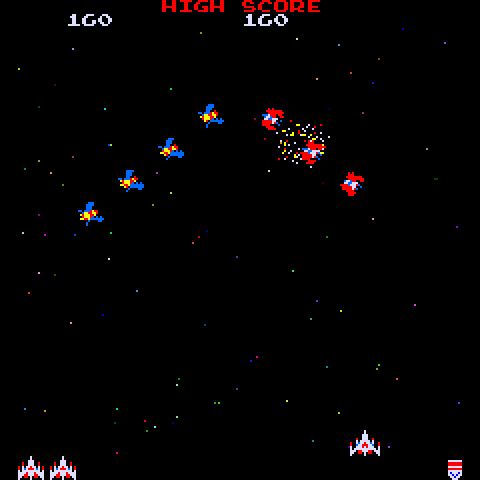

# 12 · Galaga: three processors, a sound chip and a tall screen

Galaga (Namco, 1981) is the third cartridge and by far the largest: the cabinet runs three Z80 processors, its aliens fly programs stored in the ROM, and its music comes from Namco's WSG sound chip. The web version in insert-coin ported all of it as pure TypeScript; this guide follows the C port of that port, the screen squeezed onto 240 rows, and the sound chip in the audio interrupt.

## How to play

The controls are Space Invaders' ([guide 05](05-graphics-and-controls.md)):

| Action | On the synth | In the simulator |
| --- | --- | --- |
| Left | OP1, OP2, OP3 | Left arrow, A |
| Fire | OP4, OP5 | Space, W |
| Right | OP6, PIT, GLO | Right arrow, D |
| Coin and start | PLAY | Enter |

One press, one rocket, as on the cabinet; at most two rockets fly at once. The difficulty, the fighters at the start and the extra-fighter scores are the factory settings, in `config.h`.

## The logic: 60 modules, one per TypeScript file

The web version splits the game the way the original splits its processors, and the C port keeps the same files and names:

| Part | Modules |
| --- | --- |
| The main processor's program | `program.c` (intro, stages, respawn), `endings.c` (challenge results, game over), `update_playing.c` (the tasks of one frame, in the original's order), `game.c`, `attract.c` |
| The flight processor | `flight.c`, `flight_commands.c`, `flight_bombs.c`, `flight_slot.c`: 12 slots, each running a flight program read from the ROM (`FLIGHT_ROM`) one command at a time |
| The formation | `formation.c` (sway while the waves enter, breathe afterwards), `attack_waves.c`, `wave_launcher.c` |
| Attacks and combat | `attacks.c` (who dives, with which escorts), `combat.c`, `hits.c`, `bombs.c`, `bomber_timers.c`, `rockets.c`, `fighter.c`, `score.c`, `extra_lives.c`, `clone_attack.c` |
| The capture | `capture_state.c`, `tractor_beam.c`, `capture_fighter.c`, `rescue.c` |
| Objects and stars | `objects.c`, `object_states.c` (explosions, scores, aliens turning upright), `stars.c`, `star_control.c` |
| Data | `rom.c`, `art.c`: tables generated from the web version by `tools/galaga/extract-rom.mjs`, not edited by hand |

**State changed in place.** The TypeScript builds a new state at every change. Galaga's state is about 2.3 KB, and nested changes would pile copies onto a firmware stack of about 24 KB, so the Galaga modules receive a pointer to the game's state and change it in place, one frame at a time (`update_game()`). They stay pure in every other way: no global variables, no hardware, and the same state with the same inputs always gives the same result. Where a module needs several parts of the state, it gets a small struct of pointers to them (`FlightWorld`, `AttackWorld`, `ObjectWorld`). This is the one difference in style from the other games, noted in [CLAUDE.md](../CLAUDE.md); the explanation is at the top of `flight.h`.

**Integers only.** The original is Z80 code, so the web version already works in bytes and 16-bit words; `z80_math.c` keeps its division and angle routines exactly, including their quirks (a division by zero gives $FFFF, odd octants come out one step short).

## Proof: four games, 58,000 frames

`tools/traces/record-galaga.mjs` plays the web version with scripted controls and writes the state of every frame as a hash ([FORMAT.md](../tools/traces/FORMAT.md)):

| Trace | Frames | What it covers |
| --- | --- | --- |
| `idle` | 9,000 | Nobody plays: the aliens take the three fighters, back to the attract screen |
| `restless` | 9,000 | Left and right in turn, firing every 12 frames |
| `rescuer` | 19,000 | A bot that dodges and aims: captured, rescued (double fighter), a bonus bee, stage 5 |
| `survivor` | 21,000 | The same bot, more careful: two challenging stages, stage 6 |

`parity_test.c` replays them: every frame of the C game has exactly the web version's state. Next to each trace, a **sound trace** hashes what the three voices of the sound chip play, a line per second; `sound_parity_test.c` replays the same controls through the C sound board and must match all of them.

Every TypeScript test file of the game is ported too (`*_test.c`), plus tests for what only the port has: the palette, drawing, the sound board, the controls and the squeezed screen.

## The screen: 288 rows on 240

The monitor of the cabinet stands upright: 224 × 288. Luca chose to squeeze it rather than crop or scroll it: of every 6 rows the last is left out (`SHOWN_ROWS` in `config.c`, 48 runs of 5 rows), and 288 / 6 × 5 = 240. The columns stay 1:1. Text and sprites lose a line here and there, but the whole playfield, scores and reserve fighters included, stays on screen.

Drawing follows the original's hardware: 16 × 16 sprites and 8 × 8 characters of 2 bits a pixel (`tiles.c`), coloured through the lookup PROMs (`palette.c`), and the 05xx starfield (`stars.c`, `render.c`). The colours are the 32 of the colour PROM plus the 64 star colours: 97 indexes of the shared 128-colour table ([guide 10](10-launcher.md)).

## The sound: Namco's WSG chip

The other games play sound effects described as data ([guide 06](06-sounds.md)). Galaga's sound is a program: the original's third processor runs it 120 times a second, writing the three voices of the WSG chip, which plays 8 waveforms of 32 four-bit samples from a PROM. The port has the same two halves:

- **The sound program** (`sound_program.c`, `sound_effects.c`, `sound_tracks.c`, `sound_data.c`, `sound_state.c`): pure logic, ticked twice a frame. Each frame the game's commands are written to its trigger registers first (`sound_commands.c`: the sounds started in the frame, the sounds that last as long as something happens, the direction of the breathing formation), then `sound_board.c` ticks it twice and keeps the voices of both ticks in a `WsgFrame`.
- **The chip** (`libs/audio/wsg.c`): in the audio interrupt, 44,100 times a second, it steps each voice's counter and adds the samples to the mix, the first tick's voices for the first half of the frame and the second's after. It is shared code, ready for Pac-Man.

The launcher hands the chip's voices to the audio interrupt through two slots (`audio_voices()` in `libs/audio/audio_fm1.h`): the main loop fills the slot the interrupt is not reading, then counts it as posted. The simulator does the same in `launcher/sim/sim.c`.

The fighter's explosion is not on the WSG: on the cabinet it is a noise from another chip, shaped by an analog circuit. As in the web version, it is a filtered noise that fades in about a second, an ordinary sound effect of the synthesizer (`SOUND_EFFECTS` in `config.c`).

## Size and speed

The Galaga cartridge needs 2.8 KB of state, well inside the launcher's 16 KB. The largest stack frame of the game is 1.6 KB (`draw_stars`, with the 256 stars the chip can show); `-fstack-usage` on the host compiler puts no frame above that. The ROM data (flight programs, sound data, sprites, characters) is about 20 KB of constant tables in flash.

On the real synth the things no test on the computer can tell remain to be confirmed: that a frame of Galaga, the busiest of the three games, fits in 16.7 ms, and how the squeezed screen looks.
